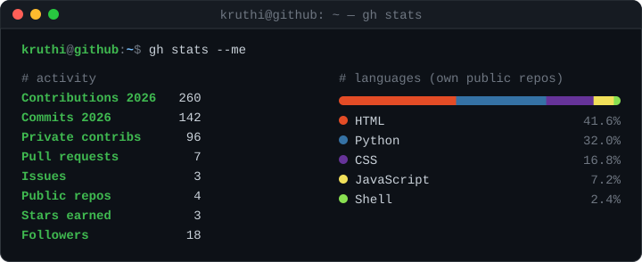

  
  
  
  
  
  

### `$ ls -t ~/repos | head -5`

<!-- REPO-LIST:START -->
- `2026-10-30` [Kruthi_PhD_Updates](https://github.com/InspireKruthirao/Kruthi_PhD_Updates) · Repository containing code, data, and documentation of PhD project
- `2026-10-30` [vibe-workshops-dogs](https://github.com/InspireKruthirao/vibe-workshops-dogs) · Structure and first look at the dog gut MAG dataset from the vibe-workshops intro se…
- `2026-10-27` [dossier](https://github.com/InspireKruthirao/dossier) `fork` · A self-hosted job search app that writes tailored resumes and cover letters from you…
- `2026-09-28` [GMSC-mapper](https://github.com/InspireKruthirao/GMSC-mapper) `fork`
- `2026-09-15` [index.html](https://github.com/InspireKruthirao/index.html)
<!-- REPO-LIST:END -->

### `$ git log --author=kruthi --all --oneline -6`

<!--START_SECTION:activity-->
- `2026-10-30` ⬆️ pushed to [InspireKruthirao/vibe-workshops-dogs](https://github.com/InspireKruthirao/vibe-workshops-dogs)
- `2026-10-30` 🌿 branched `main` in [InspireKruthirao/vibe-workshops-dogs](https://github.com/InspireKruthirao/vibe-workshops-dogs)
- `2026-10-29` ⭐ starred [AienTech/dossier](https://github.com/AienTech/dossier)
- `2026-10-29` 🍴 forked [AienTech/dossier](https://github.com/AienTech/dossier)
- `2026-10-27` ⬆️ pushed to [InspireKruthirao/Kruthi_PhD_Updates](https://github.com/InspireKruthirao/Kruthi_PhD_Updates)
- `2026-10-26` ⭐ starred [spotify/voyager](https://github.com/spotify/voyager)
<!--END_SECTION:activity-->

↳ both lists synced every 6 hours from my public GitHub activity

### `$ gh stats --me`

### `$ snake --eat ~/contributions --year 2026`

<picture>
  <source media="(prefers-color-scheme: light)" srcset="https://raw.githubusercontent.com/InspireKruthirao/InspireKruthirao/output/github-snake.svg" />
  
</picture>

 

  <a href="https://inspirekruthirao.github.io/"><code>$ echo "thanks for stopping by 🧬"</code></a>
   
  say hi on <a href="https://www.linkedin.com/in/inspirekruthirao93939393/">LinkedIn</a> or <a href="https://bsky.app/profile/kruthirao.bsky.social">Bluesky</a>

